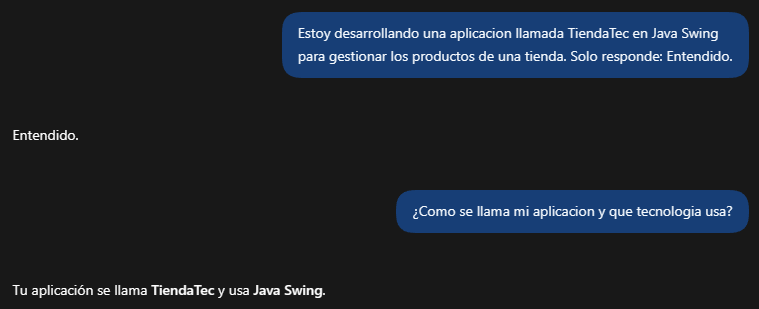
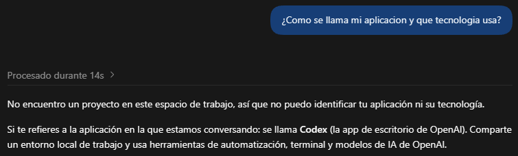
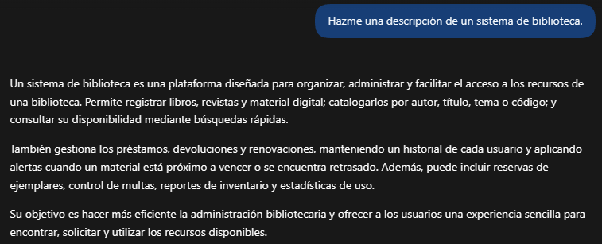
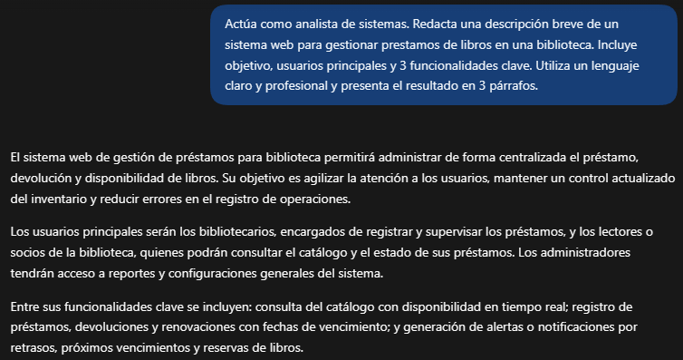

# Bitacora de prompts
 
Laboratorio 06: Fundamentos de Ingenieria de Prompts.
 
Herramienta de IA usada: ChatGPT
 
## Ejercicio 2: Tokens y ventana de contexto

| Texto | Caracteres | Tokens |
|-------|------------|--------|
| Los estudiantes programan en Java. | 34 | 7 |
| The students program in Java. | 29 | 6 |
| desafortunadamente | 18 | 4 |

### Primera conversación nueva con ChatGPT

> 💡 **Observación:** La IA al tener el contexto del primer mensaje, pudo responder correctamente el segundo mensaje.

### Segunda conversación nueva con ChatGPT

> 💡 **Observación:** Al abrir un nuevo chat la IA no tiene el historial de mensajes de los otros chats, por ello al no tener ningún contexto nos manda un mensaje de desconocimiento.

## Ejercicio 3: Temperatura

| Temperatura | % de BiblioTec | Nombres en los 5 intentos |
|-------------|----------------|---------------------------|
| 0 | 100 | BiblioTec |
| 0.5 | 65.3 | BiblioTec, LibroYa, PrestaLibro, LectoGo, PáginaLibre y NubeDeTinta |
| 1 | 44.5 | BiblioTec, LibroYa, PrestaLibro, LectoGo, PáginaLibre y NubeDeTinta |
| 1.8 | 32.2 | BiblioTec, LibroYa, PrestaLibro, LectoGo, PáginaLibre y NubeDeTinta |

## Ejercicio 4: Prompt vago vs prompt estructurado

| Criterio | Prompt vago | Prompt estructurado |
|----------|-------------|---------------------|
| Menciona el objetivo del sistema | Si | Si |
| Menciona a los usuarios principales | No | Si |
| Tiene exactamente 3 funcionalidades | No | Si |
| Esta en 3 párrafos | Si | Si |
| Lo usaría en un informe real | No | Si |

### Prompt vago

### Prompt estructurado

## Ejercicio 5: Anatomia de un prompt

| Componente | Texto de mi prompt |
|------------|--------------------|
| Rol | Desarrollador Java |
| Instrucción | Crear un programa en Java |
| Contexto | Gestionar productos de una tienda |
| Ejemplo | Usando una Clase Producto con atributos; código, nombre, precio y stock |
| Formato | Explica primero la estructura de la clase y luego presenta el código Java. |

## Observaciones en cada nivel de prompt

### Nivel 1

> Crea un programa en Java.

La IA genera un simple programa de java donde te piden un nombre para generar un saludo personalizado. 
    

### Nivel 2

> Actúa como desarrollador Java. Crea un programa en Java.

La IA al tener un rol como desarrollador espera que le indiques que programa necesita crear con los objetivos, entradas/salidas, etc.

### Nivel 3

> Actúa como desarrollador Java. Crea un programa en Java para gestionar los productos de una tienda.

La IA al tener un rol y una instrucción generá un programa de consola llamado "GestorTienda.java" donde implementa registros, listados, búsquedas, actualización de stock, cálculos del valor total del inventario, con validación de entradas.

### Nivel 4

> Actúa como desarrollador Java. Crea un programa en Java para gestionar los productos de una tienda usando una clase Producto con los atributos código, nombre, precio y stock.

Con este prompt la IA genera un programa de consola llamado "TiendaApp.java" donde incluye la clase Producto con código, nombre, precio y stock; permitiendo registrar, listar, buscar y vender productos, con validación de datos y stock disponible.

### Nivel 5

> Actúa como desarrollador Java. Crea un programa en Java para gestionar los productos de una tienda usando una clase Producto con los atributos código, nombre, precio y stock. Explica primero la estructura de la clase y luego presenta el código Java. Usa este estilo para los metodos: getPrecio( ) y setPrecio(double precio).

La IA genera una respuesta mostrando la estructura de esta forma:

La clase Producto representa cada artículo de la tienda:
- codigo: identificador único del producto.
- nombre: nombre descriptivo.
- precio: precio unitario.
- stock: unidades disponibles.
Incluye constructor, métodos getters y setters con el estilo solicitado, y un método toString() para mostrar el producto. La clase Tienda administra los productos mediante un ArrayList, permitiendo agregar, listar, buscar y vender.

Y por consiguiente muestra como está estructurado el programa siguiendo el contexto, las instrucciones, los ejemplos y los metodos que le brindamos.